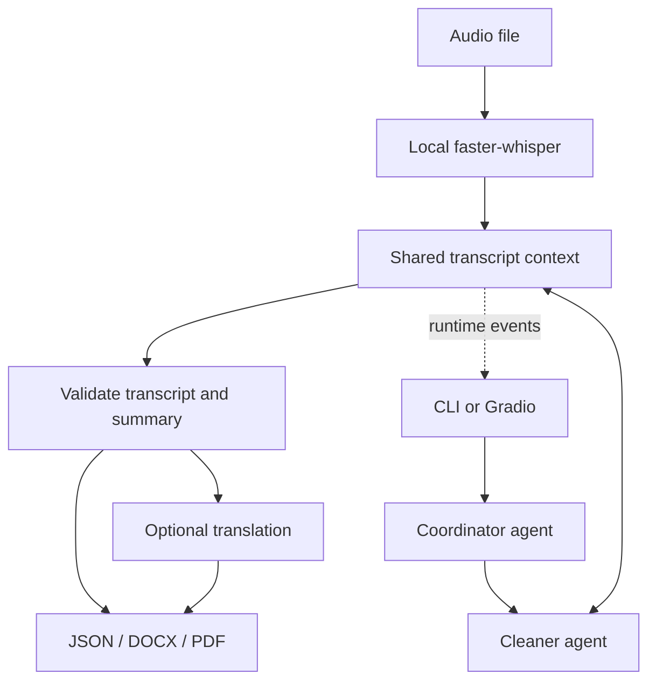

<div align="center">

# AI Audio Transcriber

**From interview audio to a transcript, a summary, and shareable documents.**

A Python pipeline combining local speech recognition with tool-using LLM agents, a Gradio interface, and optional translation.

[](https://github.com/jimmy19981226/ai-audio-transcriber/actions/workflows/ci.yml)


[](LICENSE)

[Pipeline](#pipeline) · [Quick start](#quick-start) · [Example](#example-workflow) · [Testing](#testing) · [Engineering notes](docs/ENGINEERING.md)

</div>

## Overview

Turning an interview into useful notes involves more than speech recognition. This project separates transcription, cleanup, summary validation, translation, and export into inspectable stages. It can run interactively from a terminal or through a browser interface that tracks pipeline events.

**Built on [kennionblack/ai-audio-transcriber](https://github.com/kennionblack/ai-audio-transcriber).** This fork strengthens failure handling, bounds agent execution, and adds regression tests for transcription and document exports. Upstream attribution and the MIT license are retained.

| Stage | What happens |
| :--- | :--- |
| **Transcribe** | `faster-whisper` runs the `base` model locally on CPU with int8 computation |
| **Coordinate** | A configurable agent gathers preferences and delegates the cleaning task |
| **Clean and summarize** | A cleaner agent uses tools to read the transcript and store validated text and summary bullets |
| **Translate** | An optional language-specific pass translates the transcript and summary |
| **Export** | JSON, DOCX, and PDF files share an output stem and source metadata |

## Pipeline



Speech recognition runs locally. **Transcript cleanup, summarization, and translation send text to OpenAI.** The initial Whisper model download also requires network access. See [data flow and operating limits](docs/ENGINEERING.md) before using sensitive recordings.

## Quick start

### 1. Install and configure

Use **Python 3.12+**. The first transcription downloads Whisper weights; later runs can reuse the local cache. FFmpeg is included in the development container for audio tooling.

```bash
git clone https://github.com/jimmy19981226/ai-audio-transcriber.git
cd ai-audio-transcriber
python -m venv .venv
source .venv/bin/activate
python -m pip install -r requirements.txt -r requirements-dev.txt
cp .env.example .env
```

Set `OPENAI_API_KEY` in `.env` to a key with access to the configured models. Agent models and prompts live in [`agents.yaml`](agents.yaml); translation has its model selection in [`tools/translation.py`](tools/translation.py). Model calls may incur provider charges.

### 2. Choose an interface

<table>
<tr><th>Terminal</th><th>Browser</th></tr>
<tr>
<td><code>python agent.py audio/interview.wav</code><br/>Interactive preferences and agent workflow.</td>
<td><code>python gradio_app.py</code><br/>Open <a href="http://localhost:7860">localhost:7860</a>, upload audio, and start transcription.</td>
</tr>
</table>

```bash
# Automatic mode, suitable for a scripted run:
python agent.py --mode auto audio/interview.wav

# Translate the finished output into Spanish:
python agent.py --mode auto --translate es audio/interview.wav

# Inspect the CLI without an API key or model download:
python agent.py --help
```

Accepted file extensions: **MP3, WAV, M4A, FLAC**. Translation codes: `en`, `zh`, `fr`, `es`, `de`, `ja`, `ko`, `pt`, `ar`, `ru`. See the PDF character-set limitation below when exporting translations.

## Example workflow

This is an **illustrative input/output example**, not a measured model result:

> **Spoken input:** “Um, let's test the onboarding flow on Friday. Priya will recruit three participants, and I'll prepare the script.”
>
> **Cleaned transcript:** “Let's test the onboarding flow on Friday. Priya will recruit three participants, and I'll prepare the script.”
>
> **Summary:** Test onboarding on Friday; Priya recruits three participants; the speaker prepares the script.

A run writes aligned files under `output/`:

```text
output/
├── interview.json
├── interview.docx
├── interview.pdf
├── interview_es.json       # when Spanish translation is requested
├── interview_es.docx
└── interview_es.pdf
```

Existing output names receive a numeric suffix. JSON contains title, timestamp, source filename, metadata, summary bullets, and transcript lines. The UI consumes structured runtime events and saves per-run logs under `logs/`.

## Engineering highlights

- **Declarative agents.** Prompts, models, and tool availability are defined in YAML, with a Python tool registry producing strict function schemas.
- **Concurrent transcription.** Speech recognition runs in a background thread; dependent tools await its result.
- **Explicit failure handling.** Missing, invalid, or silent audio raises a transcription error. Error text cannot be stored as a successful raw transcript.
- **Bounded agent turns.** Each agent invocation has a turn limit, preventing an endless non-completing response loop within that invocation.
- **Validated output state.** Transcript types, summary counts, and export ordering are checked before downstream work. Export errors prevent the translation callback from continuing with a failed output package.
- **Testable interfaces.** Core tests stub model transport and speech decoding, so ordinary test runs require no provider key or Whisper download.

## Testing

```bash
python -m pytest -q
ruff check .
ruff format --check .
```

The optional real Whisper fixture test is enabled separately:

```bash
RUN_TRANSCRIPTION_INTEGRATION=1 python -m pytest -q
```

That test may download model weights and take longer on CPU. The normal suite covers agent dispatch, nullable tool schemas, transcription failures, output validation, export failures, and document creation. CI installs runtime dependencies and runs the ordinary tests without a provider credential.

## Code guide

| File | Responsibility |
| :--- | :--- |
| [`agent.py`](agent.py) | CLI, background transcription, agent loop, completion events |
| [`agents.yaml`](agents.yaml) | Coordinator/cleaner prompts, models, and tool permissions |
| [`tools/toolbox.py`](tools/toolbox.py) | Tool registration, strict schemas, dispatch |
| [`tools/context.py`](tools/context.py) | Validated shared state and export lifecycle |
| [`tools/exporters.py`](tools/exporters.py) | JSON, DOCX, and PDF rendering |
| [`gradio_app.py`](gradio_app.py) / [`runtime_events.py`](runtime_events.py) | Browser UI and subprocess event protocol |

[`professor_framework/`](professor_framework/) is a separate reference framework retained from the repository's development history. It is not the audio pipeline's entry point.

## Operating limits

The Gradio application maintains shared process state and is intended for a local, single-user workflow. It does not provide a multi-tenant service boundary. Whisper output can contain recognition errors; LLM cleanup and summaries should be checked against source recordings. The current PDF exporter uses a Latin-1 font with character substitution, so non-Latin translations are best preserved in JSON and DOCX until a Unicode-font renderer is added. No speaker-diarization stage is implemented.

[Development containers, data flow, and contribution notes →](docs/ENGINEERING.md)
